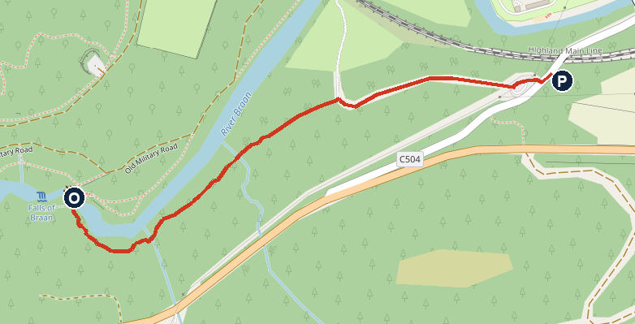

# Friday 6 November: Stirling Castle and on to Edinburgh

**Mostly dry, cloudy, maybe light drizzle.** About 8–9°C all day at Stirling and Dunkeld, with up to 20% chance of showers and a little wind. Sunset 16:24 at Stirling. This is the 3 November forecast, so check it again.

**Don't drive to the castle.** Historic Environment Scotland says the Stirling Castle car park is closed to all vehicles except coaches and accessible parking. Satnav will try to take you there. Use Castleview Park and Ride instead.

**The Edinburgh hotel is still open.** There's no address here until it's chosen.

## The day

- **About 09:40** Leave Fonab Castle. Check-out time isn't confirmed, so ask at check-in.
- **Optional, 10:05–10:50** The Hermitage, Dunkeld, 25 min from Fonab on the A9. [Open in Maps](https://www.google.com/maps/search/?api=1&query=56.5590,-3.6015)
- **10:55** Drive to Castleview Park and Ride, about 53 min. **If you skip the Hermitage,** leave Fonab about 10:30; it's about 71–76 min. [Open in Maps](https://www.google.com/maps/search/?api=1&query=Castleview+Park+and+Ride+FK9+4TW)
- **About 12:00–14:30** Stirling Castle, including the shuttle. [Open in Maps](https://www.google.com/maps/search/?api=1&query=56.1238,-3.9484)
- **About 15:00** Leave the Park and Ride for Edinburgh, about 41–43 min to the west side.
- **About 15:45** Edinburgh hotel, once chosen.
- **Dinner** On hold until the hotel is chosen.

## To do

- **Choose the Edinburgh hotel.** It needs parking, because the car stays Friday night. Shortlist in bookings.md, read on 2 November: Dalmahoy (recommended), Courtyard Edinburgh West, or Norton House. Prices will have moved.
- **Book Stirling Castle tickets online** before you leave. It's cheaper than at the door. Not bought yet.
- **Dinner:** once the hotel's chosen, book Badger & Co, or Vittoria on the Bridge, or Dishoom St Andrew Square. If you stay on the airport side, the city centre is about 25 min by car or tram.
- **Ask Fonab** about check-out time.

## Stirling Castle

**Open daily 09:30–17:00, last entry 16:00.** 01786 450 000.

- **Tickets on the official HES page today:** adult £18.50 online or £20.50 in person; child 7–15 £9 online or £10 in person.
- **The trip notes had the child price as £11.** It doesn't change anything for you unless a child ticket is needed.
- **Noah, 5:** the page starts child tickets at 7, and an older HES document says 6 and under are free. Confirm when booking.

### Getting there

1. Set the satnav to Castleview Park and Ride, FK9 4TW.
2. Take the shuttle bus. Listed at £1 adult and 50p child return, on an undated page, and it drops you about 5 min's walk from the castle. HES warns the buses can get busy at peak times. It doesn't run on Sundays.
3. The way into the castle is cobbled and sloping.

**Alternative:** council car parks at Wellgreen or Forthside. The castle is then about half a mile uphill on foot, which is a long way for Noah. I'd use the shuttle.

### For Noah to spot

- The cannons along the castle walls
- The Great Hall, and how high its roof is
- The views from the ramparts, to the Wallace Monument and across the plain
- Characters and displays in the Royal Palace, if running. I didn't check today's programme.

## Optional walk: The Hermitage, Dunkeld

**About 950 m each way on the map, with paths along the River Braan. Allow 45 min.** Open daily. Free entry. Car park £5 on the National Trust for Scotland's main page, free for members. Another of its pages says £4. The car parks are gritted in winter but the paths aren't treated for ice.

*P car park, O Ossian's Hall and the Falls of Braan (position estimated). North is up. Map © OpenStreetMap contributors.*

1. Come off the A9 at the signs for the Hermitage. NTS gives directions for northbound traffic, so follow the satnav pin as you're heading south.
2. From the car park, take the path heading west, away from the road, about 370 m. It runs below the railway towards the river.
3. Where the path meets the River Braan, turn left, upstream, with the river on your right. Keep on the main path for about 400 m.
4. Continue about 190 m more to Ossian's Hall, which overlooks the Black Linn Falls.
5. Come back the same way.

**Hold Noah's hand by the water.** NTS warns of a fast current and slippery rocks at the falls. Ossian's Hall can close for weddings, so check NTS's Facebook or Instagram.

### For Noah to spot

- Douglas firs, among the tallest trees around
- Red squirrels, if you're lucky
- The falls roaring below Ossian's Hall

## If it rains or you run late

- **Light rain:** carry on. Much of Stirling Castle is indoors.
- **Heavy rain or running late:** skip the Hermitage first.
- **Last entry at Stirling is 16:00,** so there's plenty of margin.

## Saturday 7 November

- **11:00** Drop the car at Hertz, Edinburgh Airport, Car Rental Centre, 175 Jubilee Road, EDIT50. Refuel first. Conf L758E26C0C8, renter Lobke. [Open in Maps](https://www.google.com/maps/search/?api=1&query=Hertz+Edinburgh+Airport)
- **13:25** KL928 Edinburgh to Amsterdam, lands 15:55. KLM booking Z9ZZBD.
- **After landing** Call Centraal Parkeren when you have your bags: +31 23 205 2639. Parkos ref 4H3DH4.

## Not confirmed

- **The walk:** nobody has walked these directions. They're built from OpenStreetMap and the sources below, and distances are estimates. If a sign and these notes disagree, trust the sign.
- **Castle car park:** the HES notice has no end date. It may change by Friday.
- **Park and Ride:** today's shuttle times and fares. Fares come from an undated HES page.
- **Noah's ticket:** confirm when booking.
- **Hermitage:** the parking price (£4 or £5), and whether a wedding closes Ossian's Hall.
- **Fonab check-out time.**
- **Edinburgh:** hotel, parking and dinner are all open, so I've given no address.
- **Roadworks (Traffic Scotland, read about 07:00 on 3 November):** no daytime closure showed for Friday on the A9 between Pitlochry and Stirling. The A9 Balhaldie convoy ends at 06:30 on Friday. I didn't check every entry on the M9 and Edinburgh approach, so check again on the day.
- **Drive times:** from a routing tool. The Park and Ride position in my route is approximate.

## Numbers

- Stirling Castle: 01786 450 000
- Fonab Castle: 01796 470140
- Hermitage: hermitage@nts.org.uk
- Centraal Parkeren valet: +31 23 205 2639
- Traffic Scotland care line: 0800 028 1414

## Sources

[Stirling Castle, plan your visit](https://www.historicenvironment.scot/visit/all/stirling-castle/plan-your-visit/) · [Hermitage, NTS](https://www.nts.org.uk/visit/places/The-Hermitage/planning-your-visit) · [Hermitage, NTS getting here](https://nts.org.uk/visit/places/the-hermitage/planning-your-visit) · [Roadworks](https://www.traffic.gov.scot/traffic-information/roadworks) · [Forecast](https://open-meteo.com)
