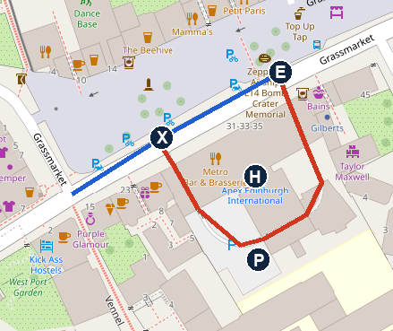
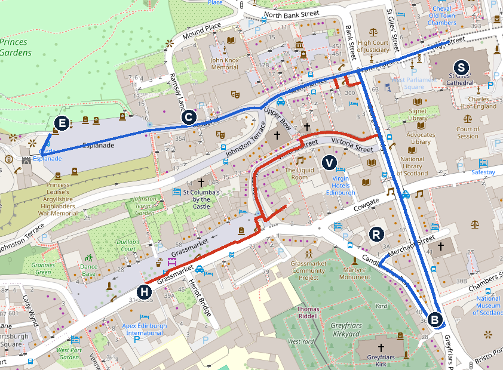

# Friday 6 November: the Hermitage, Stirling Castle and the Grassmarket

**Mostly dry and cloudy, read at 06:40 today.** Hermitage 8–9°C, dry. Stirling 8–10°C, a 30–37% chance of a light shower 11:00–13:00 (a trace only), breezier by 14:00. Edinburgh about 10°C, breezy in the afternoon, dry evening. Sunset 16:22.

**✅ Dinner booked:** Mia, Morningside, family-run Italian, 18:30 for 3. OpenTable confirmation 63543. Uber there, about 8–15 min. **Eve also held**, 18:30 for 3 via SevenRooms (18:30–20:15). Cancel whichever you don't use from its email.

**Book now on your phone:** Stirling Castle tickets for about 12:00, https://tickets.historic-scotland.gov.uk/webstore/shop/viewitems.aspx?cg=tkts&c=scp. The site blocked me.

**Rugby weekend:** Scotland v New Zealand at Murrayfield, Saturday 14:10. Expect a busy city tonight. Be at the hotel early, for the parking.

**Ring Apex today:** the booking is a City Twin Room for 2 adults, so Noah isn't on it. Ask them to add him (see To do).

**Tight bit:** leave Stirling by 14:00. Apex's car park can't be reserved, and check-in is from 15:00.

**Roadworks on the way (Traffic Scotland, read at about 06:45 today):** the A9 south of Greenloaning has lane 1 southbound closed from 09:30 for drainage. You'll pass it at about 11:00, so expect a slowdown. Temporary lights at M9 junctions 9–10 (A811 Craigforth, parapet repairs), right by the Park and Ride. Nothing listed on the M9 into Edinburgh.

## The day

**Updated 10:20 UK: left Fonab at 10:19, about 50 min late, so the Hermitage is skipped (the late-running rule below).**

- **10:20** Leave Fonab, straight to Castleview Park and Ride, FK9 4TW. About 72 min, plus a slowdown at the A9 Greenloaning lane closure. [Open in Maps](https://www.google.com/maps/search/?api=1&query=Castleview+Park+and+Ride+FK9+4TW)
- **About 11:40** Park, then take the shuttle to the castle.
- **About 11:55–13:45** Stirling Castle. [Open in Maps](https://www.google.com/maps/search/?api=1&query=56.1238,-3.9484)
- **13:45** Shuttle back to the car.
- **14:00** Leave for Edinburgh, as before. About 56 min by the routing tool; I've allowed 70.
- **Option, if you'd rather keep the Hermitage:** Hermitage 10:40–11:25, Park and Ride about 12:20, castle about 12:35–14:15, leave Stirling about 14:35, Apex about 15:45. Skip the pool, Walk 2 still at 16:30.
- **About 15:10** ✅ Apex Grassmarket Hotel, 31-35 Grassmarket, EH1 2HS. Booking.com 5084442476, check-in from 15:00. Park, then check in. [Open in Maps](https://www.google.com/maps/search/?api=1&query=Apex+Grassmarket+Hotel)
- **15:30–16:15** Pool with Noah.
- **16:30** Walk 2, Old Town sights in the dusk (below): Victoria Street, the Castle Esplanade, Camera Obscura, St Giles', Greyfriars Bobby.
- **About 16:55–18:00** Optional: Camera Obscura and World of Illusions, open to 21:00 tonight.
- **About 18:10** Uber from Greyfriars Bobby to Mia, 394 Morningside Road, EH10 5HX. 3.3 km, about 8 min without traffic; allow 15.
- **18:30** ✅ Dinner at Mia. Conf 63543.
- **About 20:30** Uber back to the hotel, 2.9 km, about 7–12 min. Mia closes at 21:00.

## To do

- **Ring Apex today,** +44 131 441 0440 (the number on your confirmation), to add Noah. The City Twin Room has 2 double beds, but Booking.com lists it for 2 people, and the hotel has no extra beds. Ask: can he share a bed in this room, is there any charge, and how much is his breakfast? If not, ask about moving to a family room.
- **Pay at the hotel:** £274, breakfast included for 2. It's non-refundable. Bring photo ID and a credit card for check-in.
- **Dinner is booked:** Mia, Morningside, 18:30 for 3, conf 63543. Order the Uber at about 18:05.
- **Book Stirling Castle** online, for about 12:00: https://tickets.historic-scotland.gov.uk/webstore/shop/viewitems.aspx?cg=tkts&c=scp. Adults £18.50 online (the page also shows £20.50, probably on the day). Under 7s look free but need a ticket, so add Noah as a free child. About £37 in all.
- **Optional: book Camera Obscura** for about 17:00: https://www.camera-obscura.co.uk/view-tickets. Adults £24.95, Noah (5–15) £17.95, so £67.85.
- **On the same call,** ask how full the car park gets before a match, how to find the entrance, and the pool's hours for children.
- **Bring** swimming things where you can reach them, and the plate number of the hire car.

## Walk 1: The Hermitage, Dunkeld

**About 950 m each way on the map, with paths along the River Braan. Allow 45 min.** Open daily. Free entry. Car park £5 on the National Trust for Scotland's main page, free for members. Another of its pages says £4. The car parks are gritted in winter but the paths aren't treated for ice.

*P car park, O Ossian's Hall and the Falls of Braan (position estimated). North is up. Map © OpenStreetMap contributors.*

1. Come off the A9 at the signs for the Hermitage. NTS gives directions for northbound traffic, so follow the satnav pin, as you're heading south.
2. From the car park, take the path heading west, away from the road, about 370 m. It runs below the railway towards the river.
3. Where the path meets the River Braan, turn left, upstream, with the river on your right. Keep on the main path for about 400 m.
4. Continue about 190 m more to Ossian's Hall, which overlooks the Black Linn Falls.
5. Come back the same way.

**Hold Noah's hand by the water.** NTS warns of a fast current and slippery rocks at the falls. Ossian's Hall can close for weddings.

### For Noah to spot

- Douglas firs, among the tallest trees around
- Red squirrels, if you're lucky
- The falls roaring below Ossian's Hall

## Stirling Castle

**Open daily 09:30–17:00, last entry 16:00.** 01786 450 000. **Don't drive to the castle.** HES says its car park is closed to all vehicles except coaches and accessible parking. Satnav will try to take you there.

1. Set the satnav to Castleview Park and Ride, FK9 4TW.
2. Take the shuttle bus. It was listed at £1 adult and 50p child return, on an undated page, and drops you about 5 min's walk from the castle. HES warns the buses can get busy at peak times.
3. The way into the castle is cobbled and sloping.

**If you miss a shuttle** and time is short, cut the castle visit rather than the 14:00 departure.

### For Noah to spot

- The cannons along the castle walls
- The Great Hall, and how high its roof is
- The views from the ramparts, to the Wallace Monument
- Characters and displays in the Royal Palace, if running. I didn't check tomorrow's programme.

## Your room

**City Twin Room, 2 double beds, about 22 m².** In a 2022 answer on Booking.com, the hotel said twins face the back, towards the car park, and family rooms face the castle. So expect no castle view, and less of the Grassmarket's pub noise. Guests in rooms over the car park have reported noise around 05:30.

## Parking at Apex

**£20 a day, first come, first served, on Apex's own page.** Non-guests can park there too. You can't reserve a space.

*E way in, P car park, X way out, H hotel, from map data, not checked on the ground. Blue is the Grassmarket from West Port. North is up. Map © OpenStreetMap contributors.*

1. Come in along West Port and on to the Grassmarket.
2. You pass the way out (X) first, on your right. Don't take it.
3. Turn right at E, through the passage on the east side of the hotel. It's a one-way loop.
4. Some spaces are tight, so take a wide one if you can. Guests have found this car park hard to find, so if you can't see it, ring reception.
5. **At reception, ask straight away how to register the car.** A visitor reported a fine after parking under 5 minutes.
6. Guests report no lift from the car park to reception, so take only what you need at first.

**If it's full:** go to NCP Castle Terrace, EH1 2EW, about 5 min by car. 750 spaces, 2.08 m height limit, £38 for 9–24 hours on the day. About 7 min on foot to the hotel. [Open in Maps](https://www.google.com/maps/search/?api=1&query=NCP+Castle+Terrace+Edinburgh)

**Low Emission Zone:** central Edinburgh has one, for petrol below Euro 4 and diesel below Euro 6. A recent hire car should pass. I couldn't confirm that the hotel is inside it.

## The pool

Heated indoor pool with a sauna, and a shallow end. It's small and a bit dated, and guests describe it as warm. You pass reception to get there, so bring a robe or layer. Booking sites say under-16s need an adult, and one lists hours of 07:00–22:00.

## Walk 2: Old Town sights, then an Uber to dinner

**About 2 km on the map, with a climb up Victoria Street. Allow 2 hours with Camera Obscura, or about 1 hour without.** Cobbles and pavements, all lit.

*H hotel, V Victoria Street, E Castle Esplanade, C Camera Obscura, S St Giles', B Greyfriars Bobby, R Eve, now cancelled, so ignore it. Red is the way up, blue the way down. Get the Uber at B. North is up. Map © OpenStreetMap contributors.*

1. **16:30** Turn right out of the hotel along the Grassmarket. At the end, bear left up West Bow into Victoria Street, the curved, colourful one linked to Diagon Alley.
2. At the top, turn left on George IV Bridge, then left again on to the Royal Mile and walk uphill to the castle.
3. **About 16:45** Castle Esplanade in the last light, with the castle lit up. Look north over Princes Street Gardens to the New Town.
4. **About 16:55–18:00, optional** Camera Obscura and World of Illusions, on the left as you come back down. Six floors of illusions, mirror maze and a rooftop with views over the lit-up city; after dark the camera itself runs a projection show instead. Open to 21:00 tonight. Stairs only, and some mirror rooms can make people dizzy.
5. Walk down the Royal Mile to St Giles' Cathedral. Find the Heart of Midlothian, the heart set in the cobbles outside.
6. Turn right down George IV Bridge, about 300 m, to the little statue of Greyfriars Bobby on the corner.
7. **About 18:05** order an Uber to Mia, 394 Morningside Road, from the Greyfriars Bobby corner. **18:30 dinner.**
8. After dinner, Uber back to the hotel, about 7–12 min.

**If you skip Camera Obscura**, slow down on the Esplanade and Royal Mile, or go back to the hotel for half an hour after St Giles'.

### For Noah to spot

- The wizard shops on Victoria Street
- The castle lit up from the Esplanade
- His own face stretched and squashed in the mirrors at Camera Obscura
- The heart in the cobbles outside St Giles'
- Greyfriars Bobby, the faithful little dog. Who did he wait for?

**Skip the kirkyard in the dark:** a guide warns it can feel spooky.

## Dinner: Mia, Morningside ✅

- **Booked:** 18:30 for 3, OpenTable confirmation 63543, under David. Table for 2 hours. 10 min grace, so ring if later: 0131 629 1019.
- **Where:** Mia, 394 Morningside Road, EH10 5HX, in Morningside, south of the centre. No parking listed, so Uber both ways.
- **Food:** family-run Italian, open since 2013, mains £25 and under. OpenTable 4.6 (1,224 reviews). Casual. Open daily 12:00–21:00.
- **For Noah:** OpenTable tags it child-friendly, and reviewers mention kids enjoying cheesy penne and small pizzas. I didn't find a kids' menu.
- **Note on the booking:** "2 adults and a 5 year old".
- **Eve is also held:** the OpenTable booking was cancelled, then rebooked directly on SevenRooms, 18:30 for 3, note "2 adults and a 5 year old". Cancel link in the "Your Reservation at EVE" email. 0131 526 4810.
- **Backups:** O'Oliviero, 64 Grassmarket, 0131 226 3706 (phone only). Metro, in the hotel, open to 20:45.

## Saturday 7 November

- **07:00–10:30** Breakfast at Apex, included for 2 adults. Noah's isn't on the booking.
- **By 10:00** Leave Apex, checking out by 11:00 at the latest. The airport route runs past Murrayfield on match day. It's about 26 min by the routing tool. The 10:00 is my estimate.
- **On the way** Refuel.
- **11:00** Drop the car at Hertz, Edinburgh Airport, Car Rental Centre, 175 Jubilee Road, EDIT50. Conf L758E26C0C8, renter Lobke. [Open in Maps](https://www.google.com/maps/search/?api=1&query=Hertz+Edinburgh+Airport)
- **13:25** KL928 Edinburgh to Amsterdam, lands 15:55. KLM booking Z9ZZBD.
- **After landing** Call Centraal Parkeren when you have your bags: +31 23 205 2639. Parkos ref 4H3DH4.

## If it rains or you run late

- **Light rain:** carry on. Much of Stirling Castle is indoors.
- **Running late:** skip the Hermitage first. Fonab to the Park and Ride direct is about 72 min, so leave by about 10:15 for the same castle time.
- **Noah has had enough:** skip Walk 2. The pool is the thing he'll want.

## Not confirmed

- **Noah at Apex:** whether the hotel accepts him in this room, and any charge.
- **Your room's position:** from the hotel's 2022 answer.
- **Apex parking:** number of spaces, height limit and how to register the car. The route in comes from undated map data.
- **Stirling Castle tickets:** not booked. Prices from HES's page; which price is online isn't stated.
- **Camera Obscura:** not booked, and tonight's availability not checked.
- **Castle Esplanade:** whether it's open to walk on after dusk.
- **Mia's kids' menu:** not found; only reviews mention children's dishes.
- **Uber:** times from a routing tool without traffic. I didn't check child-seat options.
- **The walks:** nobody has walked these directions. They're built from OpenStreetMap and the sources below, and distances are estimates. If a sign and these notes disagree, trust the sign.
- **Castle car park:** the HES notice has no end date.
- **Park and Ride:** shuttle times and fares. Fares come from an undated HES page.
- **Noah's castle ticket:** confirm when booking.
- **Hermitage:** the parking price, and whether a wedding closes Ossian's Hall.
- **Drive times:** from a routing tool, without traffic. The allowances are my estimates.
- **Roads:** trunk roads only, read at about 06:45 today. City streets aren't covered.

## Numbers

- Apex Grassmarket: +44 131 441 0440 (confirmation), 0131 300 3456 (Apex's website)
- Apex booking: Booking.com 5084442476
- Mia, Morningside: 0131 629 1019 (conf 63543)
- Camera Obscura: https://www.camera-obscura.co.uk/view-tickets
- Stirling Castle: 01786 450 000
- Fonab Castle: 01796 470140
- Centraal Parkeren valet: +31 23 205 2639
- Traffic Scotland care line: 0800 028 1414

## Sources

[Apex Grassmarket](https://www.apexhotels.co.uk/destinations/edinburgh/apex-grassmarket-hotel/) · [Apex on Booking.com](https://www.booking.com/hotel/gb/apexgrassmarkethotel.en-gb.html) · [Metro](https://www.apexhotels.co.uk/destinations/edinburgh/apex-grassmarket-hotel/dining/) · [NCP Castle Terrace](https://www.ncp.co.uk/find-a-car-park/car-parks/edinburgh-castle-terrace) · [Mia on OpenTable](https://www.opentable.co.uk/r/mia-morningside-edinburgh) · [Camera Obscura hours](https://www.camera-obscura.co.uk/opening-hours) · [Camera Obscura prices](https://www.camera-obscura.co.uk/view-tickets) · [Stirling Castle tickets](https://tickets.historic-scotland.gov.uk/webstore/shop/viewitems.aspx?cg=tkts&c=scp) · [Family directory, O'Oliviero](https://familyfriendlyuk.co.uk/restaurants/ooliviero-edinburgh) · [Rugby fixture](https://www.autumn-internationals.co.uk/2026/scotland-v-new-zealand.html) · [Low Emission Zone](https://edinburgh.gov.uk/lezemissionstandards) · [Stirling Castle, plan your visit](https://www.historicenvironment.scot/visit/all/stirling-castle/plan-your-visit/) · [Hermitage, NTS](https://www.nts.org.uk/visit/places/The-Hermitage/planning-your-visit) · [Roadworks](https://www.traffic.gov.scot/traffic-information/roadworks) · [Forecast](https://open-meteo.com)
