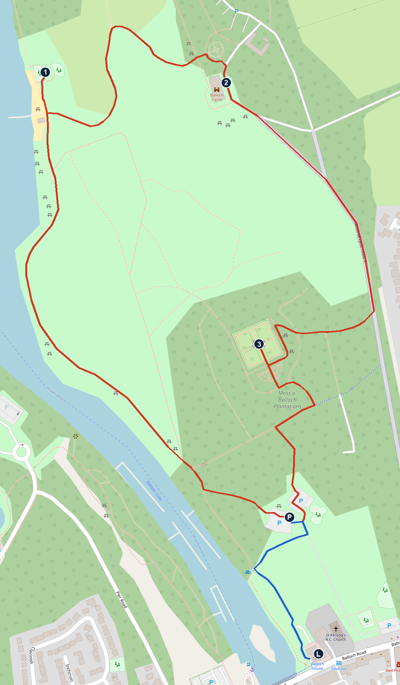
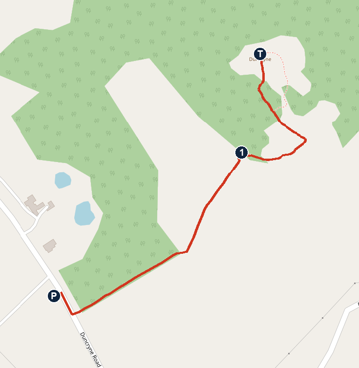

# Monday 2 November: Balloch and Duncryne

**Dry all day and almost no wind.** About 6–7°C at 10:00, 10°C at 14:00. Cloudy until noon, brightest from 13:00. Sunset 16:35.

## The day

- **09:15** Leave the Glasgow Marriott (check-out 12:00). Drive 35–45 min.
- **10:05** Park at Balloch, by the play park. [Open in Maps](https://www.google.com/maps/search/?api=1&query=56.0060,-4.5814)
- **10:15–12:15** Country park loop, about 3 km (Walk 1).
- **12:30** ✅ Lunch at The Balloch House, 3 guests, ref T11D140024021875. Leave the car where it is and walk, 5 min. [Open in Maps](https://www.google.com/maps/search/?api=1&query=The+Balloch+House+Balloch+G83+8LQ)
- **13:50** Toilet stop at the pub, then drive to the Duncryne lay-by, about 10 min. [Open in Maps](https://www.google.com/maps/search/?api=1&query=56.03770,-4.51740)
- **14:05–15:15** Climb Duncryne, "the Dumpling", and come back (Walk 2). Bring boots or wellies.
- **15:20** Drive to JA Mar Hall, about 30 min. Arrive about 15:50. Booking.com 5393178629. [Open in Maps](https://www.google.com/maps/search/?api=1&query=JA+Mar+Hall+Bishopton)
- **16:05–16:30** Short walk in the grounds if Noah still has legs. Ask reception for a route.
- **About 18:00** Dinner at Mar Hall, once booked.

## To do

**Phone Mar Hall on +44 141 812 9999 to book dinner.** Book The Dining Room (open daily for dinner, smart casual). The Clubhouse's official hours only cover Tuesday to Sunday, so it may be closed tonight. Ask about a children's menu.

## Walk 1: country park

**About 3 km, mostly tarmac, one gentle climb. Allow 2 hours with play.** Toilets at the Castle, 09:00–14:30. Walled garden usually open 10:00–15:00. The Castle itself is closed, so it's outside only.

*Red is the walk, blue is the walk to lunch. P car park, 1 play park, 2 Castle and toilets, 3 walled garden, L lunch. North is up. Map © OpenStreetMap contributors.*

### P to play park (1): 1.1 km, 20 min

1. Walk to the far end of the car park, away from the entrance, and take the tarmac path into the trees towards the river.
2. After about 230 m you reach the River Leven, with boats moored. Turn right so the water is on your left.
3. Stay on the tarmac beside the water for about 800 m. The river opens into the loch. If the path forks, take the side nearest the water. Ignore paths going off to the right.
4. You reach a boathouse, slipway and small beach. Note the tarmac path going off to the right here, as you'll come back to it.
5. Carry on about 60 m to the play park, on your right.

**If Noah is done here:** walk back the same way, 1.1 km, and skip the Castle. The next toilets are then at lunch.

### Play park to Castle (2): 650 m, 15 min

1. Walk back to the boathouse and turn left onto the tarmac path heading away from the loch.
2. Follow it uphill across the parkland for about 470 m. It swings left up the slope, then right along the edge of the woods.
3. At the top, by the round garden, carry on a few metres and turn right to the Castle. Toilets are at the Castle.

### Castle to walled garden (3): 850 m, 15 min

1. With the Castle on your right, walk past its far end and down the tarmac track.
2. At the fork after about 90 m, keep right.
3. Stay on this wide tarmac route, heading downhill for about 420 m. It's part of National Cycle Route 7.
4. Near the houses on your left, turn right onto the smaller path into the trees. Walkhighlands mentions orange arrows on this section. Follow it about 190 m to the corner of the walled garden.
5. Turn left and keep the garden wall on your right, round to the stone archway on the south side.

### Walled garden to P: 500 m, 10 min

1. Leave by the same archway and follow the path straight ahead (white pebbles) to its end.
2. Turn left for about 85 m until you meet a wider tarmac path.
3. Turn right onto it for about 80 m. At the next junction, turn left.
4. Follow the tarmac down for about 140 m to the upper car park, then through to the lower car park where you started.

### P to lunch (L): 370 m, 5 min

1. Leave by the car park entrance. At the first bend in the access road, turn right along the track towards the river, about 120 m.
2. Turn left onto the riverside path. The Balloch House is about 200 m ahead.

**Simpler alternative:** stay on the access road past St Kessog's Church to Balloch Road, then turn right.

## Walk 2: Duncryne, "the Dumpling"

**About 1.25 km there and back, with 88 m of climb. Short but steep near the top, and can be very muddy. Allow 1 hour 10 with Noah:** about 30 min up, 15 at the top, 25 down. Adults take about 20 min each way. Aim to be heading down by 15:00.

**Wear boots or wellies**; the village's own page says trainers at the very least. Keep spare socks and a bag for muddy shoes in the car. I found no toilets here, so go before leaving the pub.

*P lay-by (position approximate), 1 kissing gate into the hill's woodland (position estimated), T top. North is up. Map © OpenStreetMap contributors.*

### Getting there and parking

1. From Balloch, take the A811 east to Gartocharn. Go through the village and take the first right after the Hungry Monk, into Duncryne Road. Postcode for the GPS: G83 8RZ.
2. About half a mile up, there's a lay-by on the left beside the woods. It only has space for a few cars. Don't block any farm gates.

**If the lay-by is full:** go back down Duncryne Road, turn left onto the A811, then almost immediately right into Church Road. The [Millennium Hall car park](https://www.google.com/maps/search/?api=1&query=56.0443,-4.5239) is at the end. It's about 15 min on foot back to the lay-by at adult pace, so the easiest option is to drop Lobke and Noah at the lay-by first, and collect them the same way. Otherwise you'd reach Mar Hall nearer 16:30.

### The walk

1. From the lay-by, go through the signposted gate into the trees. The village says you can't miss the signs at the gate.
2. Follow the path through the first wood. It's a gentle start.
3. Go through a kissing gate out of the wood, then a further gate. Cross the fields on a grassy lane between two fences. This is the muddiest stretch, and there may be sheep.
4. Go through another kissing gate into the woodland on the hill itself. Follow the path round to the right.
5. The path gets steeper as it climbs the bracken slope onto the bare top. Hold Noah's hand here; the sides are steep, and the village asks you to stick to the path and keep children in sight.
6. Come back the same way. Close any gates behind you.

### At the top

- **The trig point:** the pillar that marks the summit, a good target for Noah.
- **Loch Lomond and its wooded islands:** the main view, looking north.
- **Ben Lomond:** the big mountain dominating the view. On a clear day you may also pick out The Cobbler and Ben Vorlich.
- **The Campsies, and Arran:** the Campsies are across the other way. Arran, to the west, only shows on a very good day.
- **Tom Weir:** the Scottish climber lived in Gartocharn and called this "the finest viewpoint of any small hill in Scotland".

## If it rains

Skip the hill and go to SEA LIFE Loch Lomond, 4 min from lunch, then Mar Hall (20 min). [Open in Maps](https://www.google.com/maps/search/?api=1&query=SEA+LIFE+Loch+Lomond)

- Open today 11:00–16:00, **last entry 14:50**. You must pre-book online.
- Adults £21 on the day, from £14 online. Child price not seen.
- Parking: 50p for 30 min, £1.50 for 2 hours, £2 for 4 hours, paid on arrival.
- Loch Lomond Shores shops next door: most open until 17:30.

## Not confirmed

- **The walks:** nobody has walked these exact directions. They're built from OpenStreetMap, Walkhighlands and the Gartocharn village site, and the distances are estimates. If a sign and these notes disagree, trust the sign and the map.
- **Balloch car park:** Google doesn't name it. It's inferred to be the council's Moss O' Balloch car park because it's next to a play park. Shown as free on map data and in guides, but no council tariff found, so check the sign. Fallback: Drymen Road Car Park, listed as free. [Open in Maps](https://www.google.com/maps/search/?api=1&query=56.0044,-4.5762)
- **Duncryne access:** it's private land with a public route arranged with the owner. I found no closure notice, but nothing dated this month either, and the newest walker report I read is from 2023. If the gate is signed shut, respect it and use the rain plan.
- **Duncryne path:** guides give 1.1 to 1.6 km for the round trip; I've used Walkhighlands' 1.25 km, which fits the map. One guide says part of the path was resurfaced a few years ago. The forecast model shows almost no rain in the last four days, which may help, but I have no report of today's ground. The 1 hour 10 with Noah is my estimate.
- **Mar Hall:** one listing says check-in is from 16:00, so the room may not be ready at 15:50. I found no map of the grounds walks.
- **Drive times:** Google showed 7 min to the lay-by and 28 min on to Mar Hall this morning, and a routing tool gave up to 11 and 29, so the plan allows 10 and 30. Traffic Scotland showed nothing on the A82 at Balloch or the Erskine Bridge this morning.

## Numbers

- JA Mar Hall: +44 141 812 9999
- The Balloch House: 01389 752579

## Sources

[Park visit info](https://www.west-dunbarton.gov.uk/leisure-parks-events/parks-and-greenspaces/parks/balloch-castle-country-park/balloch-castle-visits) · [Park walk](https://www.walkhighlands.co.uk/lochlomond/balloch-castle.shtml) · [Walled garden](https://www.scotrail.co.uk/inspiration-hub/things-to-do/balloch-castle-country-park) · [Duncryne walk](https://www.walkhighlands.co.uk/lochlomond/duncryne.shtml) · [Gartocharn: the walk](https://gartocharn.org/local-interest/duncryne/walk-to-the-top) · [Gartocharn: Duncryne](https://www.gartocharn.org/local-interest/duncryne) · [Duncryne guide](https://www.seelochlomond.co.uk/discover/duncryne-hill) · [Loch Lomond Waterfront](https://www.loch-lomond-waterfront.co.uk/things-to-do/walking-hiking/duncryne-hill/) · [Walker report, Jan 2023](https://www.walkhighlands.co.uk/Forum/viewtopic.php?f=9&t=116443) · [SEA LIFE hours](https://www.visitsealife.com/loch-lomond/plan-your-visit/before-you-visit/opening-hours/) · [SEA LIFE tickets](https://www.visitsealife.com/loch-lomond/tickets-passes/) · [Shores parking](https://lochlomondshores.com/your-visit/parking/) · [Shores hours](https://lochlomondshores.com/opening-hours/) · [The Clubhouse](https://www.jaresortshotels.com/restaurant-detail/scotland/ja-mar-hall/the-clubhouse) · [The Dining Room](https://www.jaresortshotels.com/restaurant-detail/scotland/ja-mar-hall/the-dining-room) · [Road incidents](https://www.traffic.gov.scot/traffic-information/incidents) · [Forecast](https://open-meteo.com)
