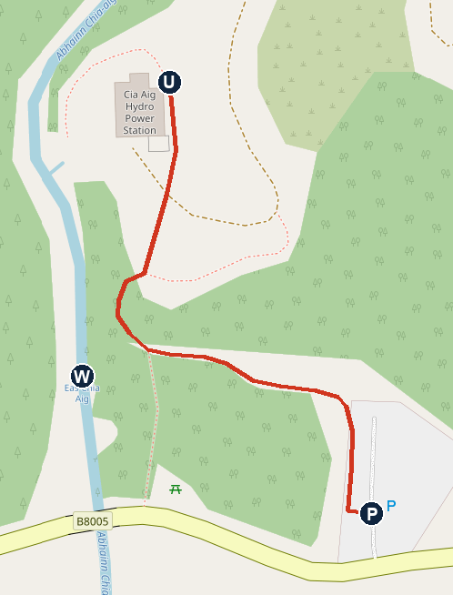
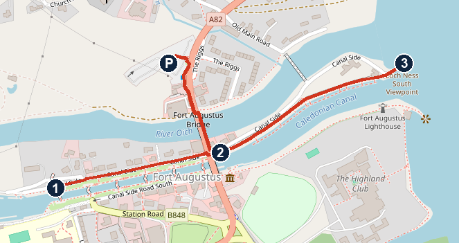
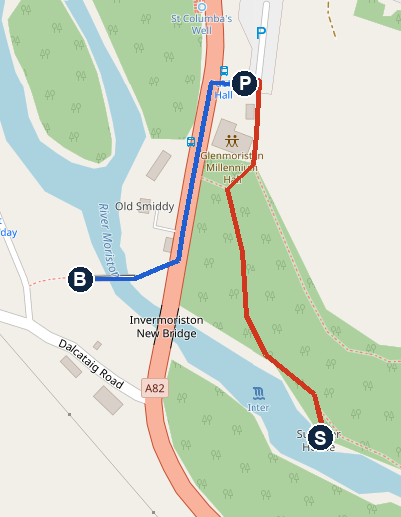
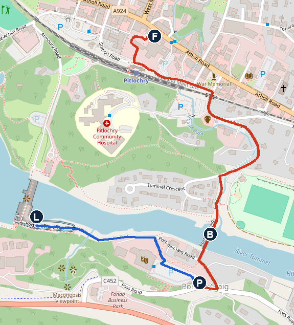

# Thursday 5 November: the Witch's Cauldron, Loch Ness and the Enchanted Forest

**Dry all day.** About 6°C at 08:00 and 8°C at 10:00 at Bluebell. About 8°C at Fort Augustus at midday, with gusts around 25 km/h. About 8°C at Pitlochry at 16:00, a few spots possible, then down to about 5°C by 20:00. Sunset 16:23 at Pitlochry. This is the forecast read at about 06:25 today.

**Leave Bluebell at 09:00.** Check-out is by 10:00, but 09:00 is what makes all the walks fit. It's a long driving day: about 3h45 on the routing tool, more like 4h30 with the lights.

**The fixed time:** 17:15 at Fishers Hotel, Pitlochry, for the Enchanted Forest bus. The time starts a 15–20 min check-in window, so you have until about 17:30.

## If you leave later

- **By 09:00:** everything below.
- **About 09:30:** go straight to lunch at Fort Augustus and do the Loch Ness stroll afterwards. Skip the fish ladder, and check in at Fonab after the forest.
- **About 10:00:** skip Invermoriston. Leave Fort Augustus by 13:30 and you're in Pitlochry about 15:50, so you get the fish ladder back.
- **Whatever happens:** leave Invermoriston by 14:15, or Fort Augustus by 14:30.

## The day

- **09:00** Leave Bluebell. About 49 min by the routing tool. I've allowed 65 for the lights.
- **10:05–10:40** Walk 1, the Witch's Cauldron. Free car park, no toilets. [Open in Maps](https://www.google.com/maps/search/?api=1&query=56.95517,-4.9997)
- **10:40** Drive to Fort Augustus, about 41 min. I've allowed 50.
- **11:30–12:00** Walk 2, the locks to the Loch Ness shore. [Open in Maps](https://www.google.com/maps/search/?api=1&query=57.1467,-4.6820)
- **12:00–12:50** Lunch, Lock Inn, Canalside. Toilets here. [Open in Maps](https://www.google.com/maps/search/?api=1&query=Lock+Inn+Fort+Augustus)
- **12:55** Drive to Invermoriston along the loch, about 8 min, plus today's new lights. Look right for Cherry Island (below).
- **13:10–13:45** Walk 3, the old bridge and the Summer House. [Open in Maps](https://www.google.com/maps/search/?api=1&query=57.21362,-4.61708)
- **13:45** Drive to Pitlochry, about 2h05 by the routing tool. I've allowed 2h25. Back through Fort Augustus, then A82 to Spean Bridge, A86, A889 to Dalwhinnie, A9 south. The one toilet stop I'd plan: House of Bruar on the A9, about 15–20 min before Pitlochry. I didn't check its hours today.
- **About 16:10** Fonab Castle. Booking.com 5051820619. Drop the bags, and give Noah a proper snack. [Open in Maps](https://www.google.com/maps/search/?api=1&query=Fonab+Castle+Hotel+Pitlochry)
- **16:25** Drive to the Pitlochry Festival Theatre car park, about 2 min. [Open in Maps](https://www.google.com/maps/search/?api=1&query=Pitlochry+Festival+Theatre)
- **16:30–17:10** Walk 4, the fish ladder at dusk, then over the suspension bridge to Fishers.
- **17:15** ✅ Check in at Fishers Hotel, PH16 5BN. [Open in Maps](https://www.google.com/maps/search/?api=1&query=Fishers+Hotel+Pitlochry)
- **About 17:45–19:15** The Enchanted Forest. The organisers suggest 60–90 min. The circuit is about 1.8 km, and you can go round again.
- **About 19:30** Back at Fishers (my estimate). Walk 15–20 min to the car, then 2 min to Fonab.
- **About 20:00** Dinner idea: Fonab's 1892 Grill. Not booked yet.

**Early-bird extra:** if you're all up and packed by 08:00, the Glencoe Lochan is 6 min the other way from Bluebell. Pine woods and a still lochan, about 45 min, coins for parking. Take everything with you, as you pass the cottage again at about 09:00. [Open in Maps](https://www.google.com/maps/search/?api=1&query=Glencoe+Lochan)

## To do

- **Ring Fonab,** 01796 470140: a bed or cot for Noah, a dinner table about 20:00, and whether there's a children's menu. Say you'll arrive about 16:10, or may check in after the forest.
- **Ring the Lock Inn,** 01320 366302, once it's open, to check they're serving lunch. I couldn't confirm it.
- **Enchanted Forest e-ticket:** See Tickets order 130768425. Have it on a phone to scan. It's non-refundable.
- **Bring** a torch for the walk back to the car, plus hats, gloves and warm layers. Coins or a card for Fort Augustus parking.

## Walk 1: the Witch's Cauldron (Eas Chia-aig)

**About 350 m each way on the map, climbing gently. Allow 35 min.** A double waterfall falling into a deep brown pool, reached by a road through the Mìle Dorcha, the Dark Mile, a deeply wooded valley. It's where Liam Neeson leaps into the pool in the 1995 film Rob Roy. The local legend says a woman accused of witchcraft was chased over the falls, so you may want to tell Noah a softer version.

*P car park, W the falls and pool, U the hydro power station at the end of the path. North is up. Map © OpenStreetMap contributors.*

### Getting there

1. Take the A82 north through Fort William to the Commando Memorial, just after Spean Bridge.
2. Turn left on the B8004 to Gairlochy.
3. Cross the canal, and turn right on the B8005 by Loch Lochy.
4. At Clunes, follow the road left through the Dark Mile. It's narrow, so use the passing places.
5. The small car park is on the right, just before the bridge over the falls river.

### The walk

1. Take the path from the top of the car park, heading uphill and west through the trees.
2. Follow it to the fork above the river, about 150 m. The falls and the pool are down to your left. The map doesn't show a path right to the pool, so stop where it's safe.
3. Carry on up the path, about 200 m, to the small power station. Then come back the same way.
4. On the way back, the other branch at the fork leads down to the road and a picnic table. From there you can see the river from the road bridge, but watch for cars.

### For Noah to spot

- The two waterfalls, one above the other
- The Witch's Cauldron. Can he see the water swirling?
- The tall trees of the Dark Mile
- The Commando Memorial on the way back past it: three giant soldiers looking towards Ben Nevis. It's a 5-min stop if you're ahead of time.

**Stay back from the edge:** I couldn't confirm any fencing, and wet rock by a pool is slippery.

## Walk 2: the locks to the Loch Ness shore

**About 1 km in all on the map, flat, on pavements and canalside paths. Allow 30 min.** The Lock Inn is right by the swing bridge, so you finish at lunch.

*P car park, 1 top of the locks (position estimated), 2 swing bridge on the A82, 3 Loch Ness viewpoint. North is up. Map © OpenStreetMap contributors.*

1. Park in the Fort Augustus car park, 57.1467, -4.6820. It's listed as paid, so check the sign.
2. Walk back to the A82 and turn right, south, over the River Oich bridge. Carry on to the canal swing bridge, about 260 m.
3. Look up the five locks towards 1. Walk up if there's time; it's about 330 m each way.
4. Cross the road, and follow Canal Side with the canal on your right, about 380 m, to the Loch Ness viewpoint at 3.
5. Come back along Canal Side to the swing bridge, and lunch.
6. After lunch, walk back over the River Oich bridge to the car, about 260 m.

### For Noah to spot

- The lock gates, and how much lower the water is at each one
- The swing bridge, which turns to let boats through
- Fort Augustus lighthouse, across the canal mouth
- Nessie, of course. The loch runs for over 20 miles from here.

### Cherry Island

As you drive north from the village, look right, about 2 km on, for a tiny wooded island in the bay. It's the only island on Loch Ness, and it was built by people, 2,000–3,000 years ago depending on the source. A monk from the abbey borrowed canal diving gear to investigate it in 1908. There's a free forest car park on the left of the road near here, Allt na Crìche, but its 3 km walk has challenging climbs, so I've left it out.

## Lunch: Lock Inn

Canalside, by the swing bridge. A pub with an open fire, per its listings. Food listings vary: one says 12:00–21:30, CAMRA says open 11:00–23:00 daily, and CAMRA warns that local food times can change day to day.

**Fallbacks, hours not confirmed:** The Boathouse, by the loch; Canalside Chip Shop; Cobb's Café.

## Walk 3: the old bridge and the Summer House, Invermoriston

**About 1 km in all on the map, with some steps and woodland path. Allow 35 min.** Thomas Telford's 1813 stone bridge crosses the River Moriston right above its falls. The Summer House is a little building perched on a wooded cliff above the river.

*P car park, S the Summer House (red), B the old bridge (blue). North is up. Map © OpenStreetMap contributors.*

1. Park in the car park beside the Glenmoriston Millennium Hall, IV63 7WE. One listing says free, the map data says paid, so check the sign.
2. For the Summer House, walk south past the hall onto the path into Falls Wood, about 270 m in all, with the river on your right. Keep Noah close at the end, as it's above a cliff.
3. Come back to the hall.
4. For the old bridge, cross the A82 with care by the bus stop. It's a fast road, and I couldn't confirm a proper crossing.
5. Walk south on the far side of the road, about 130 m, then take the path on the right, with steps down to the old bridge.
6. Walk onto the bridge, then come back the same way, and cross the A82 again.

### For Noah to spot

- The falls under the old bridge. Stand in the middle and look down.
- The new bridge carrying the road next to it. Which is older?
- A leaping salmon. It's late in the year, so this is a long shot.
- St Columba's Well, about 1,500 years old by local accounts. It's marked on the map just north-west of the car park, across the A82.

## Walk 4: the fish ladder at dusk and the suspension bridge

**About 1 km to the bus, plus 1 km if you add the fish ladder. Allow 40 min with the ladder, 20 without.** You're leaving the car at the theatre, which the organisers list as the biggest car park: about 250 spaces, a 15-min walk from Fishers. The theatre is closed at night, so use the toilets at Fishers. If it's full, Ferry Road car park is an 8-min walk from Fishers, and is paid before 18:00.

*P Festival Theatre car park, L fish ladder (blue), B suspension bridge, F Fishers Hotel (red). North is up. Map © OpenStreetMap contributors.*

### The fish ladder, if you're at the car park by 16:35

1. Walk west along Port-na-Craig Road, past the theatre, towards the dam, about 500 m.
2. Look at the ladder from the path at the foot of the dam. Steps go up beside it if Noah wants to climb them.
3. Come back the same way to the car park. Sunset is 16:23, so it'll be getting dark.

### To the bus

1. From the car park, walk north-east to the Port-na-Craig suspension bridge, about 170 m.
2. Cross the river.
3. Follow the path north, up to Ferry Road and under the railway. The route on the map then runs past the station to Fishers. I'd expect other forest visitors to be heading the same way.
4. Have the e-ticket ready. Toilets at Fishers.
5. **After the forest,** come back the same way with the torch, about 15–20 min. I couldn't confirm the path is lit.

### For Noah to spot

- The 34 pools of the ladder, a staircase for fish. Salmon use it mostly from March to October, so you're unlikely to see any.
- The dam holding back Loch Faskally
- The bridge. Does it wobble when you jump?

## The Enchanted Forest

- **The bus:** your tickets get scanned at check-in, then you queue for the next bus. The ride takes about 10 min. Everyone goes by shuttle.
- **In the forest:** toilets, and three food areas with hot food and drinks. A hot snack for Noah here would help if dinner is at 20:00.
- **Getting back:** buses run constantly, and the last leaves between 22:30 and 22:45.
- **Tired Noah fallback:** room service at Fonab, 24 hours, plus a £15 tray charge. The 1892 Grill serves 18:00–21:00.

## Roads (Traffic Scotland, read about 06:30)

No daytime closure is listed on today's route, but there are a lot of lights.

- **A82 north to the falls:** lights at Onich to Corrychurrachan, and in Fort William at Belford Road to Lochybridge, and Carrs Corner.
- **A82 Loch Lochy:** emergency lights south of Laggan, on the way to Fort Augustus and again on the way back.
- **A82 Fort Augustus:** new today from 09:00. Lights between the B862 junction and the Inchnacardoch Hotel, so you pass them both ways to Invermoriston.
- **A86:** emergency lights at Ardverikie; lights from Kinloch Laggan to Laggan; mobile lane closures between Spean Bridge and Kingussie.
- **A889 south of Catlodge:** closed from 19:00 tonight, for resurfacing. You should be through by about 15:30. If you're badly delayed, the listed diversion is via the A9 and Kingussie.
- **A82 Bunree:** closed from 19:00 again, but you've left by then.
- **A9:** the listed closures at Dalnacardoch and the Pitlochry slip road are northbound. You're going south.

## If you run late

- **Cut in this order:** the fish ladder, then checking in before the forest (do it after), then Invermoriston.
- **Noah has had enough:** skip Walk 3. The forest is the thing to save his legs for.

## Not confirmed

- **Lunch:** Lock Inn's hours today.
- **Fonab:** bed or cot for Noah, children's menu, and a 20:00 table.
- **The walks:** nobody has walked these directions. They're built from OpenStreetMap and the sources below, and distances are estimates. If a sign and these notes disagree, trust the sign.
- **Walk 1:** whether the path is open all the way to the power station. An undated report mentions a closure for the hydro work upstream. I also couldn't confirm the fencing or a viewing spot at the pool.
- **Walk 3:** the A82 crossing, the path condition, and the parking charge. The Summer House position is from the map.
- **Walk 4:** whether the theatre car park charges, and path lighting.
- **Forest return time:** my estimate. The ticket doesn't say.
- **Drive times:** from a routing tool, without roadworks. The allowances for lights are my estimates. Check the sat nav before Fort Augustus.
- **House of Bruar:** hours today.

## Numbers

- Fonab Castle and 1892 Grill: 01796 470140
- Lock Inn: 01320 366302
- Enchanted Forest order: 130768425
- Traffic Scotland care line: 0800 028 1414

## Sources

[Eas Chia-aig legend and film](https://coast.scot/stories/eas-chia-eag/) · [Invermoriston Bridge and Falls](https://www.visitinvernesslochness.com/listings/invermoriston-bridge-and-falls) · [Glenmoriston points of interest](https://www.glenmoriston.net/PointsOfInterest.html) · [Invermoriston Falls walk](https://gps-routes.co.uk/routes/home.nsf/RoutesLinksWalks/invermoriston-falls-walking-route) · [Cherry Island, Canmore](https://canmore.org.uk/site/12226) · [Cherry Island, 1908 dive](https://coord.info/GC1E9BX) · [Allt na Crìche](https://www.visitinvernesslochness.com/listings/allt-na-criche) · [Fort Augustus](https://www.visitinvernesslochness.com/fort-augustus) · [CAMRA, Lock Inn](https://www.highland.camra.org.uk/viewnode.php?id=26914) · [Pitlochry salmon ladder walk](https://www.walkhighlands.co.uk/perthshire/salmon-ladder.shtml) · [Fish ladder](https://pitlochry-scotland.co.uk/local-walks/pitlochry-dam-and-fish-ladder-walk.php) · [Enchanted Forest parking](https://www.enchantedforest.org.uk/parking) · [Enchanted Forest FAQs](https://www.enchantedforest.org.uk/faqs) · [A889 closure](https://www.traffic.gov.scot/more-details?sid=cNW202649379&type=roadworks) · [Roadworks](https://www.traffic.gov.scot/traffic-information/roadworks) · [Forecast](https://open-meteo.com)
