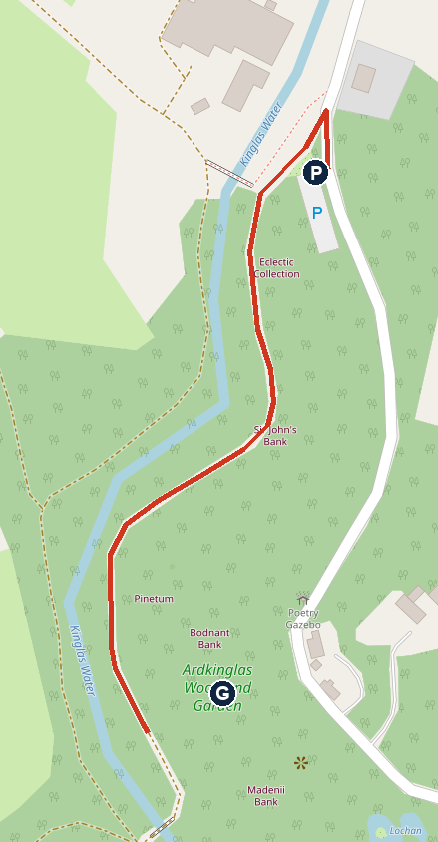
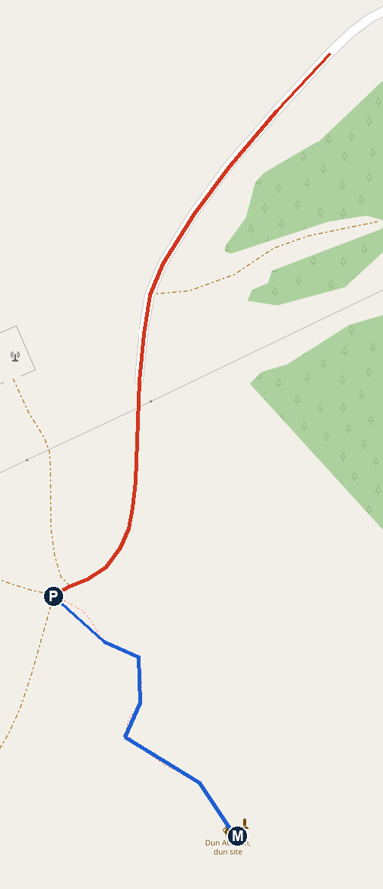
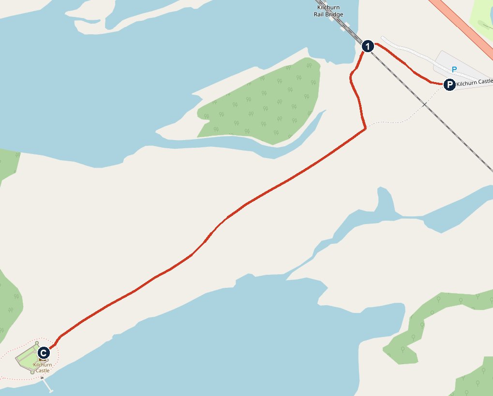

# Tuesday 3 November: Loch Fyne, Loch Awe and on to Bluebell

**Dry all day and very light wind.** About 9°C at 10:00, 10–11°C at midday, 9–10°C at 16:00. Cloudy spells, no rain forecast. Sunset 16:33 at Glencoe, 16:35 at Oban.

**The tight bit:** there are four sets of roadworks between Kilchurn and Oban today, then more on the way north (see Roads). The afternoon has no slack, so if you want Castle Stalker at sunset, cut Kilchurn short or skip it.

## The day

- **09:15** Leave JA Mar Hall. Drive about 61 min: Erskine Bridge, A82 to Tarbet, A83 over the Rest and Be Thankful. [Open in Maps](https://www.google.com/maps/search/?api=1&query=56.2529,-4.9398)
- **10:15–11:35** Walk 1, Gruffalo and Fairy Trails, Ardkinglas Woodland Garden. £12.50 for the three of you.
- **11:40** Latest to leave for Inveraray, about 17 min.
- **12:00** ✅ Lunch booked, The George Hotel, Inveraray. Table for 3, ref B6VHW2Z9, table back by 13:15. [Open in Maps](https://www.google.com/maps/search/?api=1&query=The+George+Hotel+Inveraray)
- **13:00** Drive to the monument, about 24 min.
- **13:25–13:55** Walk 2, Duncan Ban MacIntyre monument. [Open in Maps](https://www.google.com/maps/search/?api=1&query=56.3893,-5.0090)
- **13:55** Drive to Kilchurn, 5–10 min.
- **About 14:05–14:40** Walk 3, Kilchurn Castle, outside only. First thing to skip if late. [Open in Maps](https://www.google.com/maps/search/?api=1&query=56.40708,-5.01755)
- **14:40** Drive to Oban, about 36 min plus roadworks.
- **15:15–15:45** M&S Foodhall, Unit 1 Oban Retail Park, PA34 4BW, open 08:00–20:00. [Open in Maps](https://www.google.com/maps/search/?api=1&query=56.4085,-5.4735)
- **15:45** Drive to Castle Stalker, about 32 min plus roadworks.
- **About 16:20** Castle Stalker from the roadside. Sunset 16:33. [Open in Maps](https://www.google.com/maps/search/?api=1&query=56.5573,-5.3854)
- **16:30** Drive to the cottage, about 20–23 min.
- **About 16:50** Bluebell Cottage, Glenachulish, PH49 4JZ. Booking.com 6291798870, check-in 16:00–22:00, private hot tub. [Open in Maps](https://www.google.com/maps/search/?api=1&query=56.6842,-5.1937)
- **Dinner** At the cottage, or Clachaig Inn, 12 min away. Walk-in, food to 21:00, children's menu. [Open in Maps](https://www.google.com/maps/search/?api=1&query=Clachaig+Inn+Glencoe)

### Alternative finish, through Glencoe

From Kilchurn, take Rannoch Moor and Glencoe to M&S Fort William, Retail Park, PH33 6PP, open 08:00–20:00 (85 min), then Bluebell (26 min). It's about 20 min more driving, and you arrive in the dark. [M&S Fort William in Maps](https://www.google.com/maps/search/?api=1&query=M%26S+Foodhall+Fort+William)

**If you do this, be back past Onich before 19:00.** The A82 between Onich and the Corran Ferry junction closes from 19:00 for resurfacing, reopening only for short windows at 20:00 and 21:00–21:30. Leave Fort William by 18:20. Today's lights on this route are at Auch, Kingshouse, Achnacon in Glencoe, and Onich.

## To do

- **Cash for Ardkinglas:** £5 adult, £2.50 child 4–16. Cash or scan to pay; card readers are unreliable.
- **Bring** the cool bag for M&S, and strong footwear for Kilchurn.
- **M&S list:** Wednesday breakfast and lunch, Thursday breakfast, maybe tonight's dinner.

## Roads (Traffic Scotland, read about 07:00)

No closure was listed on the route today, and the A83 Rest and Be Thankful showed as open with lights. I couldn't open BEAR Scotland's own A83 page, so check signs at Arrochar.

- **Morning:** A83 Rest and Be Thankful, temporary lights, 30 mph, all day. A83 Butterbridge, speed restriction.
- **Kilchurn to Oban:** A85 Orchy Bridge lights, A85 Lochawe stop/go lining work (07:00–19:00), Bridge of Awe lights (08:00–17:00), Connel lights (07:00–19:00). Allow 10–20 min extra, which is my estimate.
- **Oban to Castle Stalker:** Connel lights again, and A828 Ledaig lights.
- **Tonight, not on your route:** A82 Tarbet closes from 19:00.

## Walk 1: Ardkinglas Woodland Garden

**About 1.5–2 km in all, on woodland paths. Allow 1 hour 15.** Open all year, dawn to dusk, no booking. I found no toilet details, so don't count on any.

*P car park, G approximate area of the Gruffalo Trail. The trails aren't on OpenStreetMap, so the red line only shows the mapped path heading that way. North is up. Map © OpenStreetMap contributors.*

1. Follow the signs from the A83 at Cairndow to Ardkinglas Woodland Garden and park. Use the pin above, 56.2529, -4.9398: it's the mapped car park, about 400 m north of the pin in the plan.
2. Pay at the car park or the pay box.
3. Take the path along the hill for about 400 m, about 5 min, to the metal Mouse sculpture. This is the start of the Gruffalo Trail.
4. Pick up a trail map from the Mouse and follow it. The trail is only about 400 m.
5. The Gruffalo is hidden at the end of the path, near the lochan.
6. Use the same map for the Fairy Trail, in the lower part of the woodland, then head back to the car park.

### For Noah to spot

- The Mouse at the start, made of steel lattice
- Tod's den, Hoolet's home and Snake's logpile. Tod is the fox and Hoolet the owl, as the boards use the Scots version of the book.
- The Gruffalo, near the lochan
- Fairies and an elf in the lower woods
- A giant silver fir, nearly 10 m round the trunk

## Lunch: The George Hotel, Inveraray

**✅ Booked: 12:00, table for 3, ref B6VHW2Z9, table back by 13:15.** 1 Main Street East, PA32 8TT. The restaurant is open daily 08:00–20:30, with four open fires. Children's menu: sausage and mash, fish and chips, chicken goujons, or macaroni cheese, £9.50 each. Ice cream £2.95. A small private car park is reached via Church Square, by the jail, and there's plenty of public parking around.

## Walk 2: Duncan Ban MacIntyre monument

**About 150 m each way on the map, uphill. Allow 30 min with the view.** The car park is free. Surface and steepness aren't published.

*Red is the road in, blue is the footpath, traced by hand from the map. P parking at the road end, M monument. North is up. Map © OpenStreetMap contributors.*

### Getting there

1. From Inveraray, take the A819 north for about 23 km to the A85.
2. Turn right on the A85 towards Dalmally, for about 1.6 km.
3. Turn right onto the Dalmally Village Loop Road (C61), for about 230 m.
4. Turn sharp right onto the narrow single-track road. Follow it for about 2 km, through the forest, to where it ends at the parking below the hill.

### The walk

1. At the parking, a track carries on south-west and another goes west to a mast. Ignore both.
2. Take the footpath heading south-east up the hill. It bends south, then south-east again, to the top.
3. Come back the same way.

### For Noah to spot

- The monument, 13.5 m of granite on top of the hill. How many Noahs tall is that?
- Loch Awe and Ben Cruachan to the west, Ben Lui to the east, the Glen Kinglass hills to the north
- Kilchurn Castle, about 2.2 km north-west. I couldn't confirm it's visible from here, so it's a real test.
- Queen Victoria is reported to have been thrilled by this view in 1875.

## Walk 3: Kilchurn Castle

**About 800 m each way on the map, flat, on a compacted path that's dirt round the castle. Allow 40 min.** Outside only: the castle is closed for conservation work. No toilets, so use the George. It's on working farmland by the loch, which floods periodically, and Historic Environment Scotland recommends strong footwear.

*P Kilchurn Castle Car Park, 1 underpass, C castle. North is up. Map © OpenStreetMap contributors.*

1. Turn off the A85 about 2.5 miles west of Dalmally into the free car park, 56.4071, -5.0176. The castle isn't signposted.
2. Walk west from the car park along the path, about 130 m, to the underpass at the railway bridge.
3. Go through the underpass and turn left, with the river on your right.
4. Follow the path south for about 170 m. Where another path comes in from the left, carry straight on, bearing south-west.
5. Stay on this straight path for about 500 m to the castle.
6. Walk round the outside on the dirt path, then come back the same way.

### For Noah to spot

- Trains on the viaduct as you go under it
- The castle's walls and tower, from every side

## Castle Stalker

A roadside stop on the A828, for the castle on its small island at sunset. Parking here is tight and limited. The Castle Stalker View café was closed in an April report and its winter hours are unknown, so don't count on it. Don't block any gates.

## If it rains or you run late

The forecast is dry, so this is mainly for running late.

- **Running late:** skip Kilchurn first, then the monument. Inveraray to Oban direct is about 1 hour.
- **Heavy rain:** shorten Ardkinglas, stay by the fire at the George, then go straight to Oban and on to Bluebell.
- **Kilchurn flooded:** turn back. The lochside floods and there's no other way round.

## Not confirmed

- **The walks:** nobody has walked these exact directions. They're built from OpenStreetMap and the sources below, and distances are estimates. If a sign and these notes disagree, trust the sign.
- **Ardkinglas:** the trail route and toilets. The estate was closed on 25 October for a weather warning; I found nothing about today. Its own pages say to pay cash, by bank transfer or by PayPal scan.
- **Monument:** path surface and steepness, whether the road is in good condition, and whether Kilchurn is visible. The path isn't in the data I could download, so I traced it from the map image. Monument size and the Queen Victoria story come from a secondary source.
- **Kilchurn:** today's flood state. "No toilets" comes from the trip notes, not the official page.
- **Castle Stalker:** the exact spot to stop.
- **Drive times:** from a routing tool, without roadworks. Google showed 39 min Kilchurn to M&S with light traffic at about 07:00.
- **M&S and Clachaig details:** from the trip notes; I didn't recheck them today.

## Numbers

- Ardkinglas Woodland Garden: 01499 600261
- The George Hotel: +44 1499 302111
- Clachaig Inn: walk-in, no booking
- Traffic Scotland care line: 0800 028 1414

## Sources

[Ardkinglas Gruffalo Trail](https://www.ardkinglas.com/the-gruffalo-trail.html) · [Wild About Argyll](https://www.wildaboutargyll.co.uk/blogs/everything-you-need-to-know-about-the-ardkinglas-gruffalo-fairy-trail/) · [George: restaurant](https://www.thegeorgehotel.co.uk/food-drink/the-restaurant) · [George: kids menu](https://www.thegeorgehotel.co.uk/food-menus/kids-menu) · [George: FAQs](https://www.thegeorgehotel.co.uk/faqs) · [Monument, Dalmally](https://en.wikipedia.org/wiki/Dalmally) · [Monument, geocache notes](https://www.geocaching.com/geocache/GCM7AX) · [Kilchurn, HES](https://www.historicenvironment.scot/visit/all/kilchurn-castle/plan-your-visit/) · [Castle Stalker View](https://appin.scot/organisation/castle-stalker-view-cafe-and-gift-shop) · [Roadworks](https://www.traffic.gov.scot/traffic-information/roadworks) · [Incidents](https://www.traffic.gov.scot/traffic-information/incidents) · [Forecast](https://open-meteo.com)
