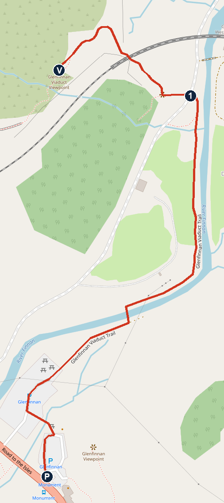
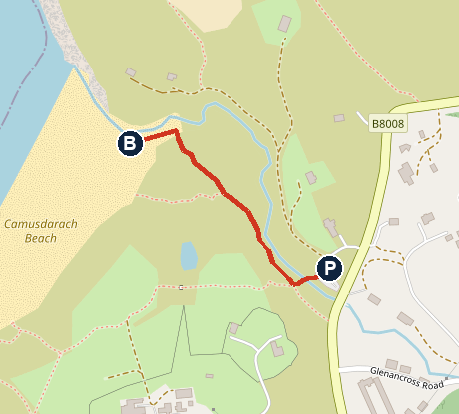

# Wednesday 4 November: the Harry Potter viaduct, Arisaig and the white sands

**Dry and calm all day.** About 7°C at 09:00, 11°C at midday, 10°C at 15:00 and 7°C at 16:00 on the coast. No rain forecast, gusts under 12 km/h. Sunset about 16:30. This is the forecast read at about 07:00 today.

**Ring first:** The Crofter's Rest on 01687 450210, to check they're serving lunch today. I couldn't confirm it. If not, ring the Lochailort Inn on 01687 467197. Do this before you pass Lochailort at about 11:45.

**The tight bit:** the train over the viaduct at about 11:03. The next one isn't until about 12:47, so be at the viewpoint by 10:50. It's the ordinary ScotRail train: the steam train has finished for the year.

**Fixed time tonight:** leave the beach by 17:00 at the very latest (my estimate). The A82 closes at Bunree from 19:00.

## The day

- **09:15** Leave Bluebell. About 51 min by the routing tool. I've allowed 65 for the lights.
- **10:20** Park at the Glenfinnan Visitor Centre, £5. Toilets open 09:30–16:00. [Open in Maps](https://www.google.com/maps/search/?api=1&query=Glenfinnan+Visitor+Centre)
- **10:25** Walk 1 to the viewpoint, about 1 km.
- **About 11:03** Watch the train cross. It leaves Glenfinnan station at 11:01. The crossing time is my estimate.
- **11:05** Walk back to the car. Hot drink at the Monument View Café if there's time.
- **11:30** Drive to Arisaig, about 28 min.
- **12:00** Lunch at The Crofter's Rest, Arisaig Hotel, PH39 4NH. Use the toilets before you leave. [Open in Maps](https://www.google.com/maps/search/?api=1&query=Arisaig+Hotel)
- **13:00** Drive to Mallaig, about 11 min.
- **13:15–14:15** Mallaig harbour: fishing boats, ferries, and maybe a seal. [Open in Maps](https://www.google.com/maps/search/?api=1&query=Mallaig+Harbour)
- **14:15** Drive to Camusdarach, about 8 min. Optional stop on the way: the Morar viewpoint (below).
- **14:25–15:50** Walk 2, Camusdarach Beach. [Open in Maps](https://www.google.com/maps/search/?api=1&query=Camusdarach+Beach+Car+Park)
- **15:50** Drive to Bluebell, about 81 min plus lights, so back about 17:25. If you stay for the sunset, you'll be back about 18:05, and that's still fine for the closure.
- **Evening** Hot tub. Dinner at the cottage, or Clachaig Inn, 12 min away. Walk-in, food to 21:00, children's menu around £8. Note your table number and order at the bar. [Open in Maps](https://www.google.com/maps/search/?api=1&query=Clachaig+Inn+Glencoe)

## To do

- **Ring** about lunch (above). Booking is recommended, so ask for a table for 3 at 12:00.
- **Bring** £5 for Glenfinnan, and coins or a card for the beach car park. Warm layers, and something Noah can get sandy and wet in.
- **Beach tide:** high at 14:49, so see the note under Walk 2.

## Walk 1: Glenfinnan viaduct viewpoint

**About 1 km each way on the map, with a short steep climb at the end. The Trust says 15–20 min; allow 25 with Noah, so about an hour and a quarter in all with the wait.**

*P Visitor Centre car park, 1 foot of the viaduct, V viewpoint. North is up. Map © OpenStreetMap contributors.*

1. From the Visitor Centre car park, cross the pedestrian bridge over the river to the community car park.
2. Follow the Glenfinnan Viaduct Trail, along the tarmac track past the farm buildings and on by the river, to the foot of the viaduct.
3. Go under the railway and take the path that climbs left (west) to the viewpoint. This is the steep part.
4. Wait at the viewpoint, what3words foggy.bloom.firewall. The train comes from the station side, then runs across the arches.
5. Come back the same way.

### For Noah to spot

- The Hogwarts Express bridge: 21 arches, 30 m high. How many Noahs is that?
- The train. Can he hear it before he sees it?
- Loch Shiel and the Glenfinnan Monument

**Paths:** a guide warns of ticks off the main path, so check legs afterwards.

## Lunch: The Crofter's Rest, Arisaig Hotel

Local seafood, with salmon and mussels smoked on site. It's the pub of a 300-year-old coaching inn overlooking Loch nan Ceall. The hotel says children are welcome until 22:00, supervised. One listing says lunch is 12:00–14:30, but other listings show evenings only, so ring.

- **Reviews:** Google 4.4 (22), TableAgent 4.58 (1,835 votes), and named by The Telegraph among 10 British pubs worth travelling for.
- **Mixed food reports:** a review 2 weeks ago called the fish, chips and mac and cheese poor. A June 2025 lunch review loved the Cullen skink and chips.
- **Backup on the road:** Lochailort Inn, 15 min after Glenfinnan, PH38 4LZ, Google 4.5. Its Cullen skink gets the praise. [Open in Maps](https://www.google.com/maps/search/?api=1&query=Lochailort+Inn)
- **Backup in Arisaig:** Soundbites café, Google 4.7 (308). I didn't check its hours. [Open in Maps](https://www.google.com/maps/search/?api=1&query=Soundbites+Arisaig)

## Optional: Morar viewpoint

Morar station is on the way from Mallaig to the beach, 5 min from Mallaig. Cross the level crossing by the station and take the footpath on the left. It's a 30 m climb to a viewpoint with a large cross. Allow 15 min. [Open in Maps](https://www.google.com/maps/search/?api=1&query=Morar+Station)

## Walk 2: Camusdarach Beach

**About 400 m from the car park to the sand on the map, about 10 min. Then as far along the beach as Noah likes. Allow about 1 hour 20.** This is the beach from the film Local Hero, with Eigg, Rum and Skye out to sea.

**High tide is at 14:49**, so there'll be less sand and the rock pools may be covered when you arrive (my reading). The tide goes out after that, and the sun drops towards the islands. No toilets here: the nearest are at the Morar Beach car park and at Traigh.

*P car park, B beach. North is up. Map © OpenStreetMap contributors.*

1. Turn off the B8008 at Glenancross, PH40 4PD. The turn is abrupt and easy to miss.
2. Park in the small car park, about 15 spaces. It's pay-and-display, first hour free, and you'll need longer than that.
3. Cross the wooden footbridge signed "To the Beaches".
4. Follow the path beside the burn, through the high marram grass.
5. On the sand, turn either way and come back the same way. Note where the path comes out, as it's hidden behind the dunes.

### For Noah to spot

- Eigg, the great wedge shape out to sea, and the peaks of Rum
- The Cuillin of Skye
- White shell sand. Look at it up close.
- The rock pools from the film, once the tide drops

**Stay back from the water:** this beach can get proper waves, and a guide warns of rip currents and fast flows around the river mouth at Morar and the headlands.

## Roads (Traffic Scotland, read about 07:40)

- **A82 Bunree, Onich to Corran:** closed from 19:00, with short openings at 20:00, 21:00–21:30, 22:30, 23:30, 01:00, 03:00 and 05:00. No diversion. These hours were read last night.
- **A82 Onich to Corrychurrachan:** temporary lights.
- **A82 Fort William:** temporary lights at Belford Road to Lochybridge, and at Carrs Corner.
- **A830 Fassfern:** temporary lights.
- **A830 Drumfern to Glenfinnan:** temporary lights.
- **A830 Fort William to Mallaig:** verge works.
- **A830 at Mallaig:** speed restriction.

## If it rains or you run late

The forecast is dry.

- **Late for the train:** see it at about 12:47 only if you're happy to have a late lunch. Otherwise look at the empty viaduct and carry on.
- **Late after lunch:** skip Mallaig and go straight to the beach. It's the better stop.
- **Noah has had enough:** Camusdarach is on the way home, so nothing is lost by leaving early.

## Not confirmed

- **Lunch:** neither pub's hours today. Ring.
- **Trains:** scheduled times from Realtime Trains, not checked for cancellations. The crossing times are my estimates.
- **Walk 1:** route from OpenStreetMap and published guides. Nobody has walked these directions, and the map's path may not be the only one. If a sign and these notes disagree, trust the sign.
- **Walk 2:** the car park price after the first hour, and how much sand is left at high tide.
- **Mallaig:** I didn't check what's open today, including the Heritage Centre.
- **Morar viewpoint:** from one family guide, dated 2017.
- **Drive times:** from a routing tool, without roadworks. The allowance for lights and the 17:00 leave-by are my estimates.
- **Tide:** predictions from Tide Times for Mallaig, not specific to the beach.

## Numbers

- The Crofter's Rest, Arisaig Hotel: 01687 450210
- Lochailort Inn: 01687 467197
- Glenfinnan Visitor Centre: 01397 722250
- Traffic Scotland care line: 0800 028 1414

## Sources

[Glenfinnan, National Trust for Scotland](https://www.nts.org.uk/visit/places/glenfinnan-monument/planning-your-visit) · [Glenfinnan viewpoints](https://scotlandlessexplored.com/glenfinnan-viewpoint/) · [Realtime Trains: Glenfinnan](https://www.realtimetrains.co.uk/search/detailed/gb-nr:GLF/2026-11-04/0900-1500) · [Arisaig Hotel food and drink](https://www.arisaighotel.co.uk/en/food-drink/) · [TableAgent](https://tableagent.com/highlands/arisaig-hotel/) · [Wild Lochaber](https://wildlochaber.com/eating-out/road-to-the-isles/arisaig-hotel-and-crofters-bar) · [Pub award](https://www.stirlingnews.co.uk/news/trendingacrossscotland/24209339.scottish-pub-named-one-best-uk-travel/) · [Lochailort Inn](https://www.thelochailortinn.co.uk/) · [Arisaig and Morar beaches](https://www.lovefromscotland.co.uk/arisaig-morar-beaches-silver-sands/) · [Beach safety](https://scotlandlessexplored.com/arisaig-beaches/) · [Morar viewpoint](https://scotlandsbestwalkswithchildren.com/2017/10/22/camusdarach-beachmorar-highland/) · [Mallaig harbour](https://www.euansguide.com/venues/mallaig-harbour-mallaig-6385/reviews/picturesque-harbour-4674) · [Tide Times](https://www.tidetimes.org.uk/mallaig-tide-times) · [Roadworks](https://www.traffic.gov.scot/traffic-information/roadworks) · [Forecast](https://open-meteo.com)
