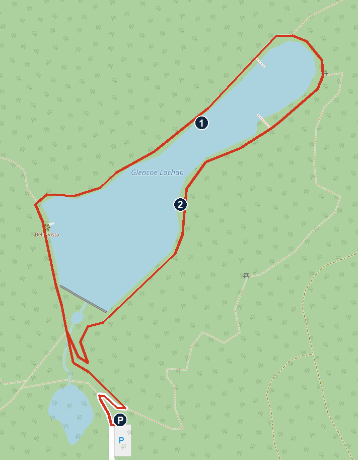

# Wednesday 4 November: over the Harry Potter viaduct, then Glencoe

**Dry, bright and calm.** About 8°C at 10:00 and 9–10°C at midday at Glenfinnan, and about 10°C in Glencoe in the afternoon. No rain forecast, gusts under 15 km/h. Sunset 16:31. This is the forecast read at about 22:30 on Tuesday, so check it again in the morning.

**The steam train has finished for the year.** This is the ordinary ScotRail train over the same bridge. It isn't booked, so check the times in the morning.

**The tight bit:** the 11:01 train. The next one towards Fort William isn't until 16:54. If you miss it, switch to the viewpoint and watch the about 12:47 crossing instead.

## The day

- **09:20** Leave Bluebell with the picnic. About 50 min to Glenfinnan by the routing tool. I've allowed 65 for the lights at Onich, Fort William and Glenfinnan.
- **10:25** Park at the Glenfinnan Visitor Centre, £5, and use the toilets. [Open in Maps](https://www.google.com/maps/search/?api=1&query=Glenfinnan+Visitor+Centre)
- **10:35** Walk to the station along the pavement, 1 km. [Open in Maps](https://www.google.com/maps/search/?api=1&query=Glenfinnan+Station)
- **11:01** Train to Fort William. It crosses the viaduct a couple of minutes after leaving (my estimate). Loch Shiel should be on your right.
- **11:35** Arrive at Fort William. Stay around the station for 43 min.
- **12:18** Train back to Glenfinnan, over the viaduct again at about 12:47, with the loch on your left.
- **12:50** Glenfinnan station. Picnic.
- **13:15–14:15** Walk back to the car over the hill, about 2 km, past the viewpoint and under the arches (below).
- **14:15** Visitor Centre: free hot drink with your train ticket at the Monument View Café, open to 16:00.
- **14:30** Drive to the Three Sisters, about 66 min plus lights. [Open in Maps](https://www.google.com/maps/search/?api=1&query=Three+Sisters+viewpoint+Glencoe)
- **About 15:50** Three Sisters viewpoint in the last of the light. This is your first look at Glencoe in daylight.
- **16:10** Drive to Bluebell, about 16 min, and the hot tub.
- **17:45** Dinner at Clachaig Inn, 12 min from Bluebell, or at the cottage. Walk-in, food to 21:00, children's menu around £8. Note your table number and order at the bar. [Open in Maps](https://www.google.com/maps/search/?api=1&query=Clachaig+Inn+Glencoe)

**Inn at Ardgour is out for tonight.** It would mean leaving Bluebell at about 16:15, and being back past Onich before the A82 closes at 19:00. Clachaig is on the side away from the closure.

## To do

- **Picnic** from the M&S shop. Bring warm layers for the viewpoint.
- **Tickets:** Glenfinnan looks to have no ticket office or machine, so buy from the conductor, or on the ScotRail app before you board. I couldn't confirm the fare or whether the conductor takes cards, so bring some cash.
- **Keep the train tickets** for the free hot drink at the café.
- **£5 for parking.** I couldn't confirm how to pay.
- **Check the morning's train times** on [Realtime Trains](https://www.realtimetrains.co.uk/search/detailed/gb-nr:GLF/2026-11-04/0700-1900).

## Walk: Glenfinnan station to the car, over the viewpoint

**About 2 km on the National Trust's figure, with a short steep climb to the viewpoint. Allow 1 hour with Noah.** The full loop from the car park is described as 4 km and 1–1.5 hours, mainly flat after the hill. I've reversed a route that's published the other way, and it isn't well signed, so ask at the station if the start isn't obvious.

1. From the station, take the signed path along the hillside towards the viaduct.
2. Carry on to the viewpoint on the hill above the viaduct, what3words foggy.bloom.firewall.
3. Go down the steep path, through the gate and under the arches.
4. Follow the path by the river and the tarmac track past farm buildings to the community car park.
5. Cross the pedestrian bridge to the Visitor Centre car park.

### For Noah to spot

- 21 arches, 30 m high. How many Noahs is that?
- Loch Shiel and the Glenfinnan Monument from the viewpoint
- The Monument: climbing it is open 10:00–12:00 and 14:00–16:00 in November, £13 for a family and 2-for-1 with a train ticket. Under-18s must be with an adult.

**Paths and water:** a guide warns of ticks off the main path, so check legs afterwards.

## Plan B: watch the train instead of riding it

- **09:00–10:15** Glencoe Lochan (walk below), 6 min from Bluebell.
- **10:15** Drive to Glenfinnan, about 53 min plus lights. Park at the Visitor Centre, £5.
- **11:30** Picnic. Walk up the steps above in reverse, starting at the community car park, to reach the viewpoint by 12:30.
- **About 12:47** The train crosses towards Glenfinnan station (my estimate, so be early).
- **13:30** Leave. Three Sisters about 14:45, the Kingshouse about 15:05, Bluebell about 15:35.

## Thursday morning option

If you ride today, Glencoe Lochan could fit on Thursday at about 08:30–09:30, 6 min from Bluebell and back to leave by 09:45.

## Roads (Traffic Scotland, read about 22:30 Tuesday)

- **A82 Bunree, Onich to Corran:** closed from 19:00 with short openings at 20:00, 21:00–21:30, 22:30, 23:30, 01:00, 03:00 and 05:00. No diversion. Clear on the morning trip, by my reading of the 19:00–06:00 hours.
- **A82 Onich to Corrychurrachan:** temporary lights.
- **A82 Fort William:** temporary lights at Belford Road to Lochybridge, and at Carrs Corner.
- **A830 Drumfern to Glenfinnan:** temporary lights, landscape work.
- **A82 Achnacon, in Glencoe:** temporary lights, 08:00–18:00 when read earlier today.
- **A82 Kingshouse:** temporary lights, only if you drive that far.

## Plan B walk: Glencoe Lochan

**About 1.7 km round the water on the map, on easy waymarked paths. Allow 1 hour 15 with play.** All the trails together are 2.5 km with 100 m of climb. The lochside path is wheelchair-accessible, per Walkhighlands. Trip notes say the main loop is graded Easy pending repairs. No facilities at the car park, per one guide, so go before you leave the cottage.

*P car park, 1 north shore, 2 east shore. The small zigzags near the car park are the routing tool's, not real turns. North is up. Map © OpenStreetMap contributors.*

### Getting there

1. From Glencoe village, take the minor road east towards the Clachaig Inn.
2. After the bridge over the River Coe, take the second of two lefts.
3. A short way up, turn right to the car park. It's well signed.

### The walk

1. Leave the car park by the path heading north towards the lochan, about 300 m, passing a smaller pond. Skip the blue Mountain Trail: Walkhighlands says it's steep.
2. Reach the lochan at its southern end, and keep it on your right along the west shore. You pass a viewpoint called Bella Vista.
3. Follow the north shore. The path runs along the water, with wooden platforms out over it.
4. Go round the far north-east end and back along the east shore, with the water on your right. There's a picnic table just off the path.
5. At the south end of the lochan, take the path back to the car park.

**Extra if Noah wants more:** the yellow woodland path adds about 1 km among the big trees.

### For Noah to spot

- Reflections of the mountains in the water, if it's still
- The wooden platforms, and which one has the best view
- Giant redwoods. The woods were planted for Lord Strathcona's Canadian wife, to make her feel at home.
- The Pap of Glencoe, the pointed peak across the water

**Stay away from the edge:** Forestry and Land Scotland has an open-water notice for the site, and a tick notice, so check legs afterwards.

## If it rains or you run late

The forecast is dry.

- **Late for the 11:01:** skip the ride and go to the viewpoint for about 12:47.
- **Running late after lunch:** skip the Three Sisters and go straight to Bluebell.
- **Heavy rain:** the train still works, but skip the hill walk and walk back along the pavement, 1 km.

## Not confirmed

- **The trains:** tomorrow's scheduled times from Realtime Trains, not checked for cancellations. The crossing times are my estimates.
- **Which side the loch is on:** worked out from the map, not from a source.
- **The walk:** nobody has walked these directions, and they reverse a route written from the car park. If a sign and these notes disagree, trust the sign.
- **Visitor Centre and café hours:** National Trust page, 09:30–16:00 daily for this period. Toilets are open during those hours.
- **Station parking:** the Trust says parking near the station is for passengers only. I couldn't check its size, so this plan uses the Visitor Centre.
- **Fare and how to pay:** not confirmed.
- **Fort William:** I didn't check what's open near the station.
- **Glencoe Lochan:** repairs and the parking price.
- **Drive times:** from a routing tool, without roadworks. The allowance for lights is my estimate.

## Numbers

- Glenfinnan Visitor Centre: 01397 722250
- Bluebell Cottage: Booking.com 6291798870
- Traffic Scotland care line: 0800 028 1414

## Sources

[Glenfinnan, National Trust for Scotland](https://www.nts.org.uk/visit/places/glenfinnan-monument/planning-your-visit) · [Glenfinnan viewpoints](https://scotlandlessexplored.com/glenfinnan-viewpoint/) · [Finding the viewpoint](https://helenabradbury.com/blog-1/how-to-find-the-glenfinnan-viaduct-viewpoint) · [Realtime Trains: Glenfinnan](https://www.realtimetrains.co.uk/search/detailed/gb-nr:GLF/2026-11-04/0700-1900) · [Realtime Trains: Fort William](https://www.realtimetrains.co.uk/search/detailed/gb-nr:FTW/2026-11-04/1030-1330) · [ScotRail ticket rules](https://www.scotrail.co.uk/about-scotrail/our-rules-travel/revenue-protection-policy) · [Glencoe Lochan, Walkhighlands](https://www.walkhighlands.co.uk/fortwilliam/glencoelochan.shtml) · [Roadworks](https://www.traffic.gov.scot/traffic-information/roadworks) · [Forecast](https://open-meteo.com)
